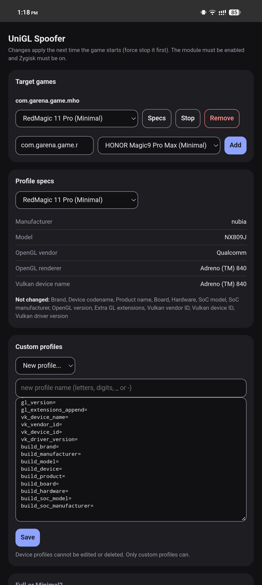

# UniGL Spoofer

A Zygisk module that spoofs **GPU info (OpenGL ES / Vulkan)** and **device identity** per app, so games and other apps
can unlock higher graphics settings. All code is written from scratch.

**Compatibility:** works with any Zygisk implementation. Android 8.0+, arm64-v8a / x86_64.

## What gets spoofed

| Area | Method |
|---|---|
| `glGetString` (vendor, renderer, version, extra extensions) | GOT hook + `eglGetProcAddress` + `dlsym` |
| Vulkan `deviceName`, `vendorID`, `deviceID`, `driverVersion` | hook `vkGetPhysicalDeviceProperties(2/2KHR)` + `vkGetInstanceProcAddr` |
| `android.os.Build` (MODEL, BRAND, MANUFACTURER, DEVICE, PRODUCT, BOARD, HARDWARE, SOC_*) | JNI static fields |
| `ro.product.*`, `ro.hardware`, `ro.board.platform`, `ro.soc.*` | hook `__system_property_get` |

## Usage

1. Make sure Zygisk is enabled, flash the zip, and reboot.
2. Open the module's **WebUI** (KernelSU / KernelSU-Next / APatch, or WebUI-X for Magisk).
3. Add the app's package name, pick a profile, **force stop** the app, and launch it again.
4. Make sure the app is **not** on a denylist or unmount list, otherwise Zygisk will not inject the module.

The configuration lives in `/data/adb/unigl/` (`targets.conf` and `profiles/*.conf`) and can be edited by hand.

## Profiles

Bundled device profiles are based on the top of the AnTuTu Android ranking (October 2026, global data).
Every device comes in two flavors:

- **Minimal**: only the GPU strings (OpenGL ES renderer and vendor, Vulkan device name), the manufacturer, and the model. Start here.
- **Full**: everything in Minimal, plus the Vulkan vendor ID, brand, board, hardware, and SoC model/manufacturer.

| # | Device | Model | GPU |
|---|---|---|---|
| 1 | HONOR Magic9 Pro Max | WKL-AN20 | Adreno 850 |
| 2 | RedMagic 11 Pro | NX809J | Adreno 840 |
| 3 | POCO F9 Ultra | 26077PC53G | Adreno 840 |
| 4 | iQOO 15 | I2501 | Adreno 840 |
| 5 | OnePlus 15 | CPH2747 | Adreno 840 |
| 6 | Xiaomi 17 Ultra | 2512BPNDAG | Adreno 840 |
| 7 | POCO F8 Ultra | 25102PCBEG | Adreno 840 |
| 8 | OPPO Find X9 Ultra | CPH2841 | Adreno 840 |
| 9 | Samsung S26 Ultra | SM-S948B | Adreno 840 |

Model numbers come from public listings (some from pre-release Geekbench entries), so double-check them if you can.
Apps may not recognize brand-new GPUs, so the Adreno 840 profiles are the safest first choice.

Use **Profile specs** in the WebUI to see exactly what a profile changes. Device profiles cannot be edited or deleted.
For anything else, use **Custom profiles** in the WebUI to create, edit, and delete your own. Every key is optional,
and an empty value leaves the real value untouched. Custom profiles are stored in `/data/adb/unigl/profiles/<name>.conf`
and are never touched by module updates.

## Limitations

- Only the app's own libraries are patched, not system libraries.
- 64-bit only.
- Packed relocations (`DT_ANDROID_RELA`) are not supported yet, so libraries that use them are not hooked.
- CPU core count, RAM, and refresh rate are not changed.
- Checks that happen on a server cannot be bypassed.
- Spoofing device identity in online games may violate their terms of service. Use at your own risk.

## Restore to normal / uninstall

- **One app only:** open the WebUI, tap **Remove** next to the app, then force stop it. It is back to normal on its next launch, and no reboot is needed.
- **Everything off:** turn the module off in your root manager and reboot. Nothing is spoofed anymore.
- **Uninstall:** remove the module in your root manager and reboot. To delete your settings as well, run
  `su -c "rm -rf /data/adb/unigl"`.
- **An app keeps crashing and you cannot open the WebUI:** run
  `su -c "rm /data/adb/unigl/targets.conf"` (or create the file `/data/adb/modules/unigl_spoofer/disable`) and reboot.
  The module only affects the apps you listed, so it cannot cause a boot loop.

## License

MIT. `src/zygisk.hpp` follows the public Zygisk API v4 (0BSD, John Wu).

## Author

Amon, on Telegram: [@xhamon](https://t.me/xhamon)
